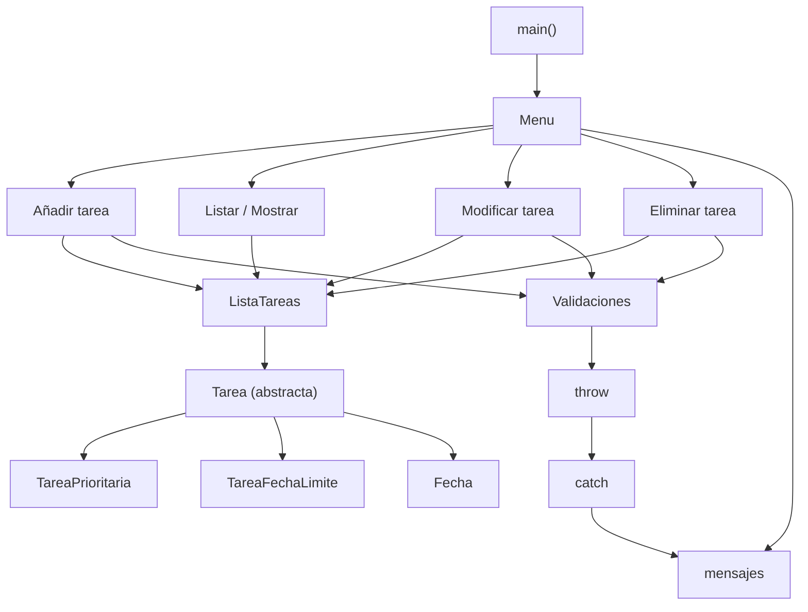
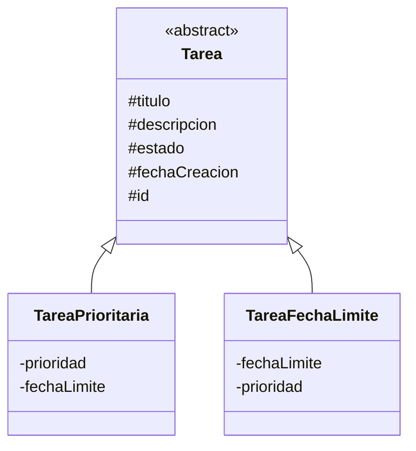
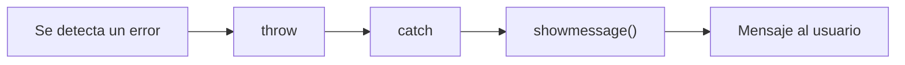
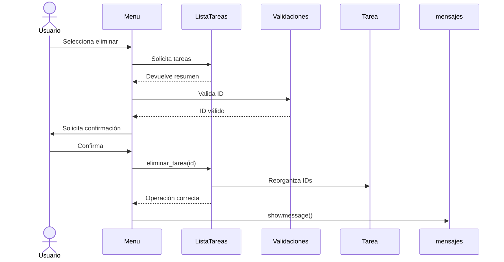

<!-- ===================== HEADER ===================== -->

<p align="center">
  
</p>

<p align="center">
  
</p>

<p align="center">


</p>

---

# ✦ Sobre el proyecto

**To-Do List** es una aplicación de consola desarrollada en **C++** para administrar tareas mediante operaciones de creación, consulta, modificación y eliminación.

El proyecto fue desarrollado para la asignatura de **Programación Orientada a Objetos**, aplicando conceptos como:

- Clases y objetos
- Encapsulamiento
- Herencia y polimorfismo
- Sobrecarga de constructores y operadores
- Modularización
- Validaciones
- Manejo de excepciones
- Separación de responsabilidades
- Trabajo colaborativo
- Control de versiones con Git y GitHub

---

# ✦ Funcionalidades

<table>
<tr>
<td width="50%">

### ➕ Gestión de tareas

- Crear tareas **prioritarias** o con **fecha límite**
- Asignar ID automáticamente (permanente)
- Guardar título y descripción
- Registrar estado
- Fecha de creación automática
- Fecha límite opcional (`s/n`)
- Prioridad `ALTA` / `BAJA`

</td>

<td width="50%">

### ⚙️ Administración

- Listar todas las tareas
- Listar por prioridad
- Listar por fecha límite
- Mostrar una tarea por ID
- Modificar nombre, descripción, estado, prioridad o fecha límite
- Eliminar tareas con confirmación
- Validar entradas

</td>
</tr>
</table>

Los estados disponibles son:

```text
0 → Pendiente
1 → En progreso
2 → Terminada
```

---

# ✦ Vista del menú

```text
╔════════════════════════════════╗
║          TO-DO LIST            ║
╠════════════════════════════════╣
║  1. Añadir tarea               ║
║  2. Eliminar tarea             ║
║  3. Modificar tarea            ║
║  4. Mostrar tarea              ║
║  5. Listar tarea               ║
║  6. Salir del programa         ║
╚════════════════════════════════╝
```

Si todavía no hay tareas, el menú solo muestra *Añadir tarea*, *Listar tarea* y *Salir del programa*.

---

# ✦ Arquitectura



---

# ✦ Estructura del proyecto

```text
TO-DO LIST
│
├── To-do list.cpp
│   └── Punto de entrada principal
│
├── Clases Tareas/
│   ├── Tarea.h
│   └── Tarea.cpp
│       └── Clase base abstracta y enum Prioridad
│
├── TareaPrioritaria.h
├── tarea_prioritaria.cpp
│   └── Tarea con prioridad (fecha límite opcional)
│
├── tareafechalimite.h
├── tarea_fecha_limite.cpp
│   └── Tarea con fecha límite
│
├── fecha.h
├── fecha.cpp
│   └── Manejo y validación de fechas dd/mm/aaaa
│
├── Lista de tareas/
│   ├── Listatareas.h
│   └── Listatareas.cpp
│       └── Administra todas las tareas
│
├── menu/
│   ├── menu.h
│   └── Menu.cpp
│       └── Controla la interacción con el usuario
│
├── Validaciones y Mensajes/
│   ├── Validaciones.h / Validaciones.cpp
│   │   └── Controla y valida las entradas
│   ├── mensajes.h / mensajes.cpp
│   │   └── Centraliza la salida de mensajes
│   └── Pruebas.cpp
│       └── Pruebas automáticas (tiene su propio main)
│
├── To-do List.slnx / To-do List.vcxproj
│   └── Proyecto de Visual Studio
│
└── xmake.lua
    └── Compilación en Linux con xmake
```

---

# ✦ Clases principales

## `Tarea`

Clase base **abstracta** que representa una tarea individual dentro del sistema.

Cada objeto contiene:

```text
┌──────────────────┐
│      TAREA       │
├──────────────────┤
│ ID               │
│ Título           │
│ Descripción      │
│ Estado           │
│ Fecha de creación│
└──────────────────┘
```

Define métodos virtuales puros (`obtenerFechaLimite()`, `obtenerPrioridad()`, `obtenerTipo()`, etc.) que cada tipo de tarea implementa a su manera.

---

## Herencia: `TareaPrioritaria` y `TareaFechaLimite`



- **`TareaPrioritaria`**: tiene **sobrecarga de constructores**. Se puede crear con o sin fecha límite.
- **`TareaFechaLimite`**: la fecha límite es obligatoria y la prioridad es `BAJA` por defecto.

---

## `Fecha`

Encapsula día, mes y año.

- Valida fechas reales, incluidos los años bisiestos (`30/02/2027` es inválida)
- Convierte desde y hacia el texto `dd/mm/aaaa`
- **Sobrecarga de operadores** `<` y `==` para comparar y ordenar fechas

---

## `ListaTareas`

Administra el conjunto completo de tareas.

Internamente utiliza punteros inteligentes, lo que permite guardar los dos tipos de tarea (polimorfismo):

```cpp
std::vector<std::unique_ptr<Tarea>> tareas;
```

Sus principales responsabilidades son:

```text
ListaTareas
│
├── agregarTarea()
├── eliminarTarea()
├── existeTarea()
├── buscarTarea()
├── cantidad()
├── obtenerTareas(TODAS | PRIORIDAD | FECHA_LIMITE)
└── cambiarEstado()
```

En resumen:

```text
Tarea
└── representa UNA tarea

ListaTareas
└── administra TODAS las tareas
```

---

## `Menu`

La clase `Menu` controla la interacción principal con el usuario.

Se encarga de:

- Mostrar las opciones
- Recibir selecciones
- Conectar las acciones
- Mostrar información mediante `showmessage()`

---

## `mensajes`

Para evitar utilizar `cout` directamente en diferentes archivos, se creó una clase encargada de centralizar los mensajes.

### Antes

```cpp
cout << "Tarea eliminada correctamente.";
```

### Ahora

```cpp
mensajes::showmessage(
    "Tarea eliminada correctamente.\n"
);
```

Esto permite que la salida del programa se encuentre centralizada.

---

# ✦ Manejo de excepciones

Los errores se manejan utilizando:

```cpp
throw
```

Por ejemplo:

```cpp
if (!lista.existe_tarea(id))
{
    throw invalid_argument(
        "Error: no existe ninguna tarea con ese ID."
    );
}
```

La excepción posteriormente se captura:

```cpp
catch (const exception& e)
{
    mensajes::showmessage(
        e.what()
    );
}
```

### Flujo



---

# ✦ Validaciones

El sistema evita entradas incorrectas mediante funciones reutilizables.

| Validación | Descripción |
|---|---|
| 🔢 Número válido | Evita letras cuando se espera un número |
| 📏 Rango | Comprueba límites permitidos |
| 📝 Texto vacío | Impide campos obligatorios vacíos |
| 📐 Longitud | Controla el tamaño máximo del texto |
| 🔎 ID existente | Verifica que la tarea exista |
| ✅ Confirmación | Acepta `s/si` y `n/no`, sin distinguir mayúsculas |
| 📅 Fecha límite | Debe existir y no puede ser anterior a la fecha de creación |

---

# ✦ Ejemplo de ejecución

```text
========== TO-DO LIST ==========

1. Añadir tarea
2. Listar tarea
3. Salir del programa

Selecciona una opcion: 1
```

Después se piden el nombre, la descripción (opcional), la prioridad y, si se quiere, una fecha límite:

- **Sin fecha límite** → se crea una `TareaPrioritaria`
- **Con fecha límite** → se crea una `TareaFechaLimite`

Al final se muestra la fecha de creación y el ID asignado automáticamente.

---

# ✦ Listado de tareas

Al listar se puede elegir el orden:

```text
1. Listar todas las tareas
2. Listar tareas prioritarias
3. Listar tareas por fecha limite
```

---

# ✦ Flujo de una operación

### Ejemplo: eliminar una tarea



---

# ✦ Mejoras realizadas

<details>

<summary><b>🔧 Ver correcciones realizadas durante el desarrollo</b></summary>

<br>

### Integración de clases

Se unificaron las diferentes versiones de `Tarea` y `ListaTareas` utilizadas durante el desarrollo, y el repositorio se limpió para dejar una sola versión del proyecto.

### Herencia y polimorfismo

`Tarea` pasó a ser una clase abstracta con dos hijas: `TareaPrioritaria` y `TareaFechaLimite`.

### Manejo de fechas

Se creó la clase `Fecha` para validar fechas y compararlas con los operadores `<` y `==`.

### IDs permanentes

Cada nueva tarea recibe automáticamente un identificador que **no cambia** aunque se eliminen otras tareas.

```text
1 → 2 → 3 → 4 → ...
```

### Pruebas automáticas

`Pruebas.cpp` contiene 36 comprobaciones de la lógica del programa.

### Validación de IDs

El programa comprueba que una tarea exista antes de modificarla o eliminarla.

### Confirmación antes de eliminar

```text
Seguro que quieres eliminarla? (s/n):
```

### Centralización de mensajes

Los mensajes anteriormente enviados mediante `cout` fueron centralizados utilizando:

```cpp
mensajes::showmessage();
```

### Manejo de excepciones

Los errores utilizan:

```text
throw
  ↓
catch
  ↓
showmessage
```

</details>

---

# ✦ Tecnologías

<p align="center">


</p>

<table align="center">
<tr>
<td align="center"><b>C++</b></td>
<td align="center"><b>Visual Studio</b></td>
<td align="center"><b>Git</b></td>
<td align="center"><b>GitHub</b></td>
</tr>
</table>

---

# ✦ Equipo

<table>
<tr>
<th>Integrante</th>
<th>Participación</th>
</tr>

<tr>
<td><b>Camila Andrea Jaimez Martinez</b></td>
<td>Estructura de <code>Tarea</code> y funcionalidad para añadir tareas</td>
</tr>

<tr>
<td><b>Ary Gabriela de la Cruz Peralta</b></td>
<td>Administración de <code>ListaTareas</code>, eliminación y validaciones</td>
</tr>

<tr>
<td><b>Sofia Watts Feria</b></td>
<td>Funcionalidad para cambiar el estado de las tareas</td>
</tr>

<tr>
<td><b>Paulina Cancino Vichi</b></td>
<td>Menú, listado de tareas e integración del programa</td>
</tr>

</table>

---

# ✦ Instalación

### 1. Clonar el repositorio

```bash
git clone https://github.com/Chavalinas/To-Do-List.git
```

### 2. Entrar al proyecto

```bash
cd To-Do-List
```

### 3. Abrir en Visual Studio

Abre la solución del proyecto utilizando:

```text
Visual Studio
```

### 4. Compilar

```text
Compilar
   ↓
Compilar solución
```

### 5. Ejecutar

```text
Depurador local de Windows
```

### En Linux (con xmake)

```bash
xmake          # compila
xmake run todo # ejecuta el programa
xmake build pruebas && xmake run pruebas  # ejecuta las pruebas
```

> `Pruebas.cpp` tiene su propio `main`, así que no se agrega al proyecto principal de Visual Studio.

---

# ✦ Objetivos de aprendizaje

Durante el desarrollo del proyecto se trabajaron conceptos como:

```text
Programación Orientada a Objetos
          │
          ├── Clases
          ├── Objetos
          ├── Encapsulamiento
          ├── Métodos
          ├── Modularización
          ├── Validaciones
          ├── Excepciones
          └── Trabajo colaborativo
```

---

# 🎓 Información académica

<p align="center">

### Universidad Autónoma de Guadalajara  
#### Campus Tabasco

**Ingeniería en Software y Minería de Datos**

**Programación Orientada a Objetos**

**Docente:** Manuel Balderas

</p>

---

<p align="center">

### ✦ TO-DO LIST ✦

Desarrollado colaborativamente en **C++**.

<br>


</p>

<p align="center">
  
</p>
